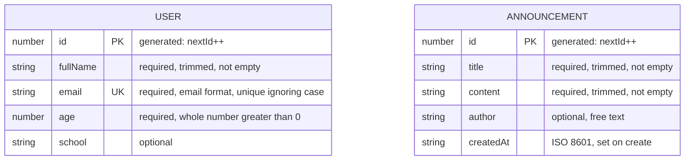

# Data Design Documentation

**Alumni Tracking System — Management Information Systems Department, Istanbul University**

Back to [README.md](README.md)

---

## 🎯 Purpose and Scope

This document describes the data in the Alumni Tracking System as it exists in the code today: the two entities (User and Announcement), their fields, types and validation rules, how input is converted, and how errors are returned. Everything here is taken from `models/User.ts`, `models/Announcement.ts`, `lib/parseBody.ts` and the four controllers. Anything that does not exist yet is in the last section and is marked **Planned (not implemented)**.

---

## 💾 Storage Overview

- **There is no database yet.** Each model keeps its records in an array in memory, inside the Node.js server process.
- **Two stores:** `models/User.ts` holds the users and `models/Announcement.ts` holds the announcements. Each store is an object `{ <records>: [...], nextId: number }`.
- **The same sample data on every start.** When the server starts, each store is created with 3 sample records and `nextId: 4`.
- **Everything is lost on restart.** Any record created, changed or deleted while the server runs is gone when the process stops. The Docker "forgetting test" in the README showed exactly this: a new announcement and a new user both disappeared after `docker compose down` and `docker compose up`, and only the 3 sample records of each were left.
- **Hot reload keeps the data.** The stores are saved on `globalThis` (`userModelStore` and `announcementModelStore`), so in `npm run dev` a code reload or a separately bundled route uses the same array instead of starting again.
- **One process only.** The data is not shared between server processes or containers.

---

## 🔤 Data Types Used

| Type | Meaning | Where it is used |
| --- | --- | --- |
| `string` | Text. Strings from clients are trimmed by the models before they are saved. | `User.fullName`, `User.email`, `User.school`, `Announcement.title`, `Announcement.content`, `Announcement.author` |
| `number` (integer) | A TypeScript `number`. In this project the code only stores whole numbers in these fields: ids are counters, and `age` must pass `Number.isInteger`. In JSON it is a number. | `User.id`, `User.age`, `Announcement.id` |
| ISO 8601 date string | A `string` made by `new Date().toISOString()`, always in UTC, for example `"2026-10-07T08:15:00.000Z"`. | `Announcement.createdAt` |
| Optional field (`?`) | The field may be missing from the record. When it is missing, the key is left out of the JSON response; it is never `null`. | `User.school`, `Announcement.author` |

---

## 📖 Data Dictionary

In both tables:

- **Required** means "must be sent when creating (POST) or replacing (PUT)". In PATCH and in the web edit forms, every field is optional, but at least one known field must be sent.
- **Null / omit**: `null` is never accepted for any field. A `null` value fails the type check and gives a `400`.
- The **Planned PostgreSQL type** column is a proposal for the future database. It is **planned, not implemented**.

### User

Source: `models/User.ts` (`type User`, `validate`, `UserModel`).

| Field | TypeScript type | JSON type | Required | Nullable or can be omitted | Default or how it is generated | Constraints and validation | Example value | Planned PostgreSQL type (planned, not implemented) |
| --- | --- | --- | --- | --- | --- | --- | --- | --- |
| `id` | `number` | integer | Yes, always present, but set by the server, never by the client | Null: no. Omit: always omitted by clients; an `id` in the body is ignored | Generated as `store.nextId++`. The sample users have ids 1–3, so the first new user gets 4. Ids are not reused after a delete. After a restart, counting starts at 4 again. | Primary key. In a URL it must be digits only (`/^\d+$/`); anything else matches no user (404). | `1` | `integer GENERATED ALWAYS AS IDENTITY PRIMARY KEY` |
| `fullName` | `string` | string | Yes (POST, PUT) | Null: no. Omit: only in PATCH / edit form | None | Must be a string. Trimmed, then must not be empty (`"fullName" must be a non-empty string.`). No maximum length in code. | `"Ayşe Yılmaz"` | `text NOT NULL` |
| `email` | `string` | string | Yes (POST, PUT) | Null: no. Omit: only in PATCH / edit form | None | Trimmed, then must match `/^[^\s@]+@[^\s@]+\.[^\s@]+$/`. Must be unique among users, ignoring case; a user keeps their own email when updating. The original case is stored. No maximum length in code. | `"ayse.yilmaz@example.com"` | `text NOT NULL`, with a unique index on `lower(email)` |
| `age` | `number` | number (integer) | Yes (POST, PUT) | Null: no. Omit: only in PATCH / edit form | None | Must be a number (a JSON string such as `"25"` is rejected), a whole number (`Number.isInteger`) and greater than 0. No maximum in code. | `24` | `integer NOT NULL CHECK (age > 0)` |
| `school` | `string` (optional: `school?`) | string, or key missing | No on POST and PATCH. **Yes on PUT** (PUT requires every field). | Null: no. Omit: yes (except PUT) | None. When missing, the record has no `school` key, and the views show "—". | If sent: must be a string, trimmed, not empty. No maximum length in code. | `"Istanbul University"` | `text NULL` |

- **Primary key:** `id`.
- **Unique fields:** `email`, compared ignoring upper/lower case.
- **Other keys** in the input (for example `phone`) are ignored and never stored.

### Announcement

Source: `models/Announcement.ts` (`type Announcement`, `validate`, `AnnouncementModel`).

| Field | TypeScript type | JSON type | Required | Nullable or can be omitted | Default or how it is generated | Constraints and validation | Example value | Planned PostgreSQL type (planned, not implemented) |
| --- | --- | --- | --- | --- | --- | --- | --- | --- |
| `id` | `number` | integer | Yes, always present, but set by the server, never by the client | Null: no. Omit: always omitted by clients; an `id` in the body is ignored | Generated as `store.nextId++`. The sample announcements have ids 1–3, so the first new one gets 4. Ids are not reused after a delete. After a restart, counting starts at 4 again. | Primary key. In a URL it must be digits only (`/^\d+$/`); anything else matches no announcement (404). | `1` | `integer GENERATED ALWAYS AS IDENTITY PRIMARY KEY` |
| `title` | `string` | string | Yes (POST, PUT) | Null: no. Omit: only in PATCH / edit form | None | Must be a string. Trimmed, then must not be empty (`"title" must be a non-empty string.`). No maximum length in code. | `"Mentors wanted"` | `text NOT NULL` |
| `content` | `string` | string | Yes (POST, PUT) | Null: no. Omit: only in PATCH / edit form | None | Must be a string. Trimmed, then must not be empty. No maximum length in code. Line breaks are kept. | `"We are looking for graduates who would like to mentor a current MIS student this semester."` | `text NOT NULL` |
| `author` | `string` (optional: `author?`) | string, or key missing | No (POST, PUT, PATCH) | Null: no. Omit: yes. On **PUT**, leaving it out **removes** the current author. | None. When missing, the views show "—". | If sent: must be a string, trimmed, not empty. Free text: it is **not** linked to a User. No maximum length in code. | `"Alumni Office"` | `text NULL` |
| `createdAt` | `string` | string (ISO 8601, UTC) | Yes, always present, but set by the server, never by the client | Null: no. Omit: always omitted by clients; a `createdAt` in the body is ignored | Set once in `create` with `new Date().toISOString()`. PATCH and PUT keep the original value. | Not validated, because clients can't set it. The views show it in Istanbul time (`formatDate` in `components/AnnouncementDetails.tsx`). | `"2026-10-07T08:15:00.000Z"` | `timestamptz NOT NULL DEFAULT now()` |

- **Primary key:** `id`.
- **Unique fields:** none besides `id`.
- **Other keys** in the input are ignored and never stored.

---

## 🔄 Type Conversion

Values pass through up to three steps on the way in: the body parser (`lib/parseBody.ts`), the model's `validate` function, and the response.

### 1. Reading the body (`parseBody`)

| Input | What happens |
| --- | --- |
| **JSON** body | Read with `request.json()`. It must be an object: invalid JSON gives `400 "Request body must be valid JSON."`, and an array, `null` or a plain value gives `400 "Request body must be a JSON object."`. The `id` key is removed. **No other conversion:** values keep their JSON types, so `"age": "25"` stays a string and is rejected by the model. |
| **Form** body (`multipart/form-data` or `application/x-www-form-urlencoded`) | Read with `request.formData()` and turned into an object by `formDataToObject`. |

`formDataToObject` (also used directly by the web controllers for the `/users` and `/announcements` forms):

| Rule | Example |
| --- | --- |
| Every form value arrives as text. | `age=25` arrives as `"25"` |
| The `age` field becomes a number if the trimmed text matches `/^-?\d+(\.\d+)?$/`. | `"25"` → `25`; `" 25 "` → `25`; `"25.5"` → `25.5` (then rejected: not a whole number); `"-3"` → `-3` (then rejected: not greater than 0) |
| If `age` doesn't look like a number, it stays text. | `"abc"` stays `"abc"` (then rejected: not a number) |
| Only `age` is converted, because it is the only name in `NUMERIC_FIELDS`. | `title=2026` stays the string `"2026"` |
| Empty fields (empty after trimming) are **skipped**, as if they weren't sent. | `school=` is ignored. On create, an empty required field gives `"… is required."`; in an edit form, it keeps the current value. |
| An `id` field is skipped. | `id=99` is ignored |
| Uploaded files are skipped. | |
| Text values other than `age` are passed on untrimmed; the model trims them. | `"  Ayşe  "` is saved as `"Ayşe"` |
| If the same name appears twice, the last value is kept. | |

### 2. Cleaning in the model (`validate`)

- Strings are trimmed (`fullName`, `email`, `school`, `title`, `content`, `author`).
- Unknown keys are dropped; only the fields listed in the model's `FIELDS` are kept.
- The cleaned fields are put in a fixed order (the order of the type), whatever order the input used.
- The model adds the generated values: `id` (both entities) and `createdAt` (Announcement).

### 3. Ids in the URL and the response

- **Ids in the URL** (`/api/users/2`, `/announcements/2/edit`) arrive as text. The controllers' `toId` turns digits-only text into a number (leading zeros are allowed, so `01` is `1`); anything else becomes `NaN`, which matches no record and gives `404`.
- **Responses** are written with `NextResponse.json`: ids and `age` are JSON numbers, `createdAt` is a string, and a missing optional field is left out (not `null`).

---

## ⚠️ Validation and Errors

### `ValidationError`

- `ValidationError` is a class in `models/User.ts` with a `message` and an optional `field`, the name of the field that failed.
- `models/Announcement.ts` imports the same class and exports it again, so both models throw the same error type.
- The models throw it. They never build HTTP responses.

The two controllers turn it into different results:

| Controller | What it returns for a `ValidationError` |
| --- | --- |
| `ApiUserController`, `ApiAnnouncementController` | HTTP `400` with `{ "error": "<message>", "field": "<field>" }`. `field` is left out when the error is not about one field. |
| `UserController`, `AnnouncementController` (web pages) | `{ ok: false, error, field }`. The form then shows the message under that field and keeps the typed values. |

Body errors use a second class, `BodyParseError` in `lib/parseBody.ts`, which carries its own status (`400` or `415`) and never has a `field`. Any other error is not caught by the controllers. It is a real bug, and Next.js answers with a server error.

### Error response shape (JSON API)

```json
{ "error": "\"email\" must be a valid email address.", "field": "email" }
```

```json
{ "error": "User \"99\" not found." }
```

### Status codes

| Code | When |
| --- | --- |
| `200` | GET, PUT or PATCH succeeded |
| `201` | POST created a record (the body is the new record) |
| `204` | DELETE succeeded (no body) |
| `400` | Validation failed (`ValidationError`), or the body could not be read (`BodyParseError`) |
| `404` | No record has this id: `User "<id>" not found.` / `Announcement "<id>" not found.` |
| `415` | The `Content-Type` is not JSON or form data |

For PUT and PATCH, the controller first checks that the record exists, and only then reads the body. So an unknown id gives `404` even if the body is also wrong. DELETE doesn't read a body.

### All validation messages in the code

| Message | Field | Entity | When |
| --- | --- | --- | --- |
| `Request body must be an object.` | — | both | The model received something that isn't an object |
| `"<field>" is required.` | the field | both | A required field is missing (POST, PUT) |
| `"<field>" must be a non-empty string.` | the field | both | A text field is not a string, or is empty after trimming |
| `"email" must be a valid email address.` | `email` | User | The email doesn't match the pattern |
| `"email" is already used by another user.` | `email` | User | Another user has this email, ignoring case |
| `"age" must be a positive whole number.` | `age` | User | `age` is not a number, not whole, or not greater than 0 |
| `Send at least one of: fullName, email, age, school.` | — | User | PATCH / edit form with no known field |
| `Send at least one of: title, content, author.` | — | Announcement | PATCH / edit form with no known field |
| `Request body must be valid JSON.` | — | both | `BodyParseError`, 400 |
| `Request body must be a JSON object.` | — | both | `BodyParseError`, 400 |
| `Request body could not be read as form data.` | — | both | `BodyParseError`, 400 |
| `Unsupported Content-Type "<type>". Use application/json, multipart/form-data or application/x-www-form-urlencoded.` | — | both | `BodyParseError`, 415 |

The checks run in this order, and the first failure is the one reported: object check, required fields, text fields, then (User only) `email`, then `age`.

---

## 📨 Input Formats

The JSON API's write requests (POST, PUT, PATCH) accept three body types:

| Content-Type | Accepted | Notes |
| --- | --- | --- |
| `application/json` | Yes | Values keep their JSON types (see Type Conversion) |
| `multipart/form-data` | Yes | Values are text; `age` is converted to a number |
| `application/x-www-form-urlencoded` | Yes | Same rules as multipart |
| Anything else, or no `Content-Type` | No | `415` with the "Unsupported Content-Type" message |

- **How the type is read:** only the part before `;` counts (so `application/json; charset=utf-8` works), and upper/lower case doesn't matter.
- **Requests without a body:** GET and DELETE don't read one.
- **Web forms:** the `/users` and `/announcements` forms are Next.js server actions. The browser sends them as form data, and the web controllers read them with `formDataToObject`.

---

## 🌱 Sample Data

The seed rows written in the models. They are loaded on every server start.

### Users (`models/User.ts`)

| id | fullName | email | age | school |
| --- | --- | --- | --- | --- |
| 1 | Ayşe Yılmaz | ayse.yilmaz@example.com | 24 | Istanbul University |
| 2 | Mehmet Kaya | mehmet.kaya@example.com | 27 | Boğaziçi University |
| 3 | Elif Demir | elif.demir@example.com | 22 | *(not set)* |

### Announcements (`models/Announcement.ts`)

| id | title | content | author | createdAt |
| --- | --- | --- | --- | --- |
| 1 | Welcome to the Alumni Tracking System | The MIS department now has one place to stay in touch with its graduates. Please keep your details up to date. | MIS Department | 2026-09-22T09:00:00.000Z |
| 2 | Alumni meetup in October | Graduates and current students are invited to an evening of talks and networking on campus. | Alumni Office | 2026-09-30T12:30:00.000Z |
| 3 | Mentors wanted | We are looking for graduates who would like to mentor a current MIS student this semester. | *(not set)* | 2026-10-07T08:15:00.000Z |

In both stores `nextId` starts at `4`.

---

## 🔗 Relationships and ER Diagram

**There are no relationships between User and Announcement today.**

- Neither entity stores the other's id.
- `Announcement.author` is free text such as `"Alumni Office"`, not a reference to a User.
- The two stores are completely separate. Deleting a user doesn't affect any announcement, and the other way round.

The diagram shows the two current entities and their fields. There is no line between them, because there is no relationship.



---

## 🛡️ Data Access Rule

**Only the models touch the data.**

- The stores (`store` in each model file) are not exported. The only way to read or change records is through the model's functions: `getAll`, `getById`, `create`, `update`, `replace` and `remove`.
- **Controllers** call those functions and never touch the arrays. The API controllers are `ApiUserController` and `ApiAnnouncementController`; the web controllers are `UserController` and `AnnouncementController`.
- **Pages and server actions** call the controllers, not the models.
- **View components** in `components/` only receive records as props. They import the `User` and `Announcement` *types* (`import type`), never the models.

This is what makes the later database switch easy: the storage code is in two files, `models/User.ts` and `models/Announcement.ts`. The function names, inputs and error type can stay the same, so the controllers, pages and views keep working.

One change will reach outside the model files, though. The model functions are **synchronous** today, and a database call is asynchronous, so they will return promises. Where a controller, page or server action calls a model function, it will need an `await`, either directly or through the controller.

---

## 🔭 Planned Data Design (Planned, not implemented)

> **Everything in this section is planned, not implemented.** None of these fields, tables or tools exist in the code yet. They are proposals based on the Upcoming list in the README. The ERD from the System Analysis and Design course is not in this repository, so this plan should be checked against it.

### Alumni entity (Planned, not implemented)

The README's Upcoming list includes alumni records with graduation details and current job, and an Alumni Directory searched by year, program, company or city. A proposed entity:

| Field (planned) | Proposed TypeScript type | Proposed PostgreSQL type | Proposed rule |
| --- | --- | --- | --- |
| `id` | `number` | `integer GENERATED ALWAYS AS IDENTITY PRIMARY KEY` | Generated by the database |
| `userId` | `number` | `integer NOT NULL REFERENCES users(id)`, unique | Links the alumni record to one User (one-to-one) |
| `graduationYear` | `number` | `integer NOT NULL` | Whole number |
| `program` | `string` | `text NOT NULL` | Not empty |
| `currentJobTitle` | `string` (optional) | `text NULL` | Not empty if sent |
| `company` | `string` (optional) | `text NULL` | Not empty if sent |
| `city` | `string` (optional) | `text NULL` | Not empty if sent |

- **Planned relationship (not implemented):** User 1 — 0..1 Alumni.
- **Planned option (not implemented):** replace the free-text `Announcement.author` with an `authorId` that points to a User.

### Move to PostgreSQL (Planned, not implemented)

- **Database:** PostgreSQL hosted on Supabase, used through Prisma (as listed in the README's Tech Stack and Upcoming sections).
- **Schema:** the Prisma schema would define the `User` and `Announcement` tables using the "Planned PostgreSQL type" columns in the Data Dictionary above, and later the `Alumni` table.
- **Rules the database would take over:**
  - ids from an identity column instead of `nextId++`;
  - a unique index on `lower(email)` instead of the array search;
  - `createdAt` from `DEFAULT now()`;
  - `CHECK (age > 0)` as a second guard behind the model's validation.

What would change (planned):

| Part | Today | After the move (planned) |
| --- | --- | --- |
| `models/User.ts`, `models/Announcement.ts` | Arrays in memory | Prisma queries; functions become `async` |
| Controllers, pages, server actions | Call the models synchronously | Add `await` where they call the models; no other changes planned |
| Views (`components/`) | Receive records as props | No change planned |
| `lib/parseBody.ts` and the validation rules | As described above | No change planned |
| Sample data | Written in the model files | A separate seed script (planned) |
| Restarts | Data is lost (forgetting test) | Data is kept, because it lives in the database, outside the app container |

---

Back to [README.md](README.md)
